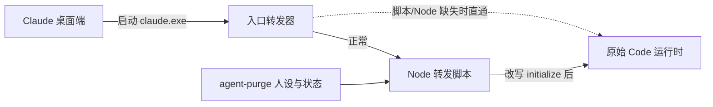

# Claude 桌面端 Code 接入

`claude-desktop` 支持 Windows 上 Claude 桌面端的**本机 Code** 模式。它与 `claude`（CLI）分开选择，可以单独指定人设和模式。Chat、Cowork、远程 SSH、WSL 和云端会话不在此入口内。需要 Node.js 20+ 和 Windows 自带的 .NET Framework 4。

## 使用

1. 在 Claude 桌面端打开一次本机 Code，等待 Code 运行时下载完成。
2. 在 agent-purge 控制台选中 `claude-desktop` 并应用，或运行 `agent-purge install claude-desktop`。
3. 回到 Claude 桌面端**新建**本机 Code 会话。人设在会话初始化时读取一次。
4. 修改人设/模式后新建会话；已有会话保持创建时的系统提示词（桌面端对会话提示词做了快照）。

```bash
agent-purge install claude-desktop
agent-purge use concise --for claude-desktop
agent-purge mode append --for claude-desktop
agent-purge uninstall claude-desktop
```

开着的 Code 会话不影响安装、重新应用或卸载：正在运行的入口文件会先被改名挪开，会话结束后下次应用时自动清理。

## 数据目录

同一台机器上桌面端可能有两套数据目录，安装时两套都会处理：

| 目录 | 说明 |
|---|---|
| `%LOCALAPPDATA%\Claude-3p` | 第三方推理（自定义网关）模式 |
| `%APPDATA%\Claude` | 官方登录模式 |

`CLAUDE_DESKTOP_DATA_DIR` 或 `CLAUDE_USER_DATA_DIR` 可指定自定义桌面数据目录，与 CLI 的 `CLAUDE_CONFIG_DIR` 无关。

## 工作方式



- 桌面端把 Code 运行时缓存在 `<数据目录>/claude-code/<版本>/<哈希>/claude.exe`，启动前只检查同目录的 `.verified` 标记，不校验 exe 本身。
- 安装时原 `claude.exe` 改名为同目录 `claude.exe.agent-purge-original.exe`（完整保留），原位置放入几 KB 的入口转发器，并写 `claude.exe.agent-purge.json` 清单。
- 转发脚本是安装时生成的**自包含单文件**，放在 agent-purge 数据目录 `claude-desktop/relay-<哈希>.mjs`，只依赖 Node 内置模块，不依赖 agent-purge 程序装在哪。
- 入口转发器**失败开放**：清单损坏、Node 或转发脚本缺失、启动失败时直接透传给原始运行时（不注入人设，但 Code 照常可用）。这种状态下控制台会显示未接入，重新应用即可。
- 转发脚本只改写 stdin 里第一帧 `control_request / initialize` 的提示词字段，其它字节原样转发，stdout/stderr 与退出码保持不变。不修改桌面端 app.asar、CLI 安装、认证、权限或工具配置。

## 模式

桌面端 Code 会话用的是 SDK 的 preset 提示词：initialize 里**不带** `systemPrompt`（运行时自己拼内置默认提示词），桌面端自己的说明放在 `appendSystemPrompt`。

| 模式 | initialize 的改写 | 模型实际收到的 system |
|---|---|---|
| off | 原样转发 | SDK 身份句 + 内置默认提示词 + 桌面端追加段 |
| append | 人设追加到 `appendSystemPrompt` | SDK 身份句 + 内置默认提示词 + 桌面端追加段 + 人设 |
| replace | `systemPrompt` 设为人设，保留桌面端追加段 | SDK 身份句 + 人设 + 桌面端追加段 |
| strict | `systemPrompt` 设为人设，去掉桌面端追加段 | SDK 身份句 + 人设 |

replace 与 CLI 的 `--system-prompt-file` 语义一致：转发层看不到内置默认正文，只能整段换掉。运行时总会在最前面加一句 `You are Claude Code, Anthropic's official CLI for Claude, running within the Claude Agent SDK.`，这是宿主残留，各模式都去不掉。想保留 Claude Code 的默认工作说明请用 append。暂停/禁用/人设丢失/状态损坏时，新会话原样转发。没有同会话热切。

## 更新与恢复

桌面端更新后会下载新版本的 Code 运行时，新版本尚未接入，需要在 agent-purge **重新应用** `claude-desktop`。探针检查全部已缓存版本，有任一版本没接入就不报告已接入。

安装记录保存在数据目录 `claude-desktop/install.json`，记录每个原文件和转发器的 SHA-256（含历史转发器版本，便于升级）。卸载时把原件改名回原位（不复制 300MB 文件，也不怕原件正被会话占用），检测到外部修改时保留文件、备份和记录并报告冲突。不要手动删除运行时旁的原始文件或清单。桌面端自行删除旧缓存目录后，记录里对应条目会在下次应用时清理。

此通道依赖桌面端当前的运行时启动协议；客户端大版本更新后建议在控制台点一次「隔离验证一次」。

## 验证

控制台的「隔离验证一次」对 `claude-desktop` 走专用流程：把本机桌面端缓存的真实运行时硬链接进临时目录，在临时数据目录里装好转发器，按桌面端的 SDK 协议发送 initialize 与一条用户消息，请求只发往本机假 provider，检查人设标记是否且仅出现在 system 层。不修改正在使用的运行时，不使用真实凭据。

```bash
node --test test/claude-desktop.test.mjs
node scripts/verify-claude-desktop.mjs
```

## 验证记录

2026-11-07：Windows 11 / 桌面端 4.23118.0 / Code 2.1.317（Claude-3p 与官方两套数据目录）。

- 单元与可执行测试：四模式改写、preset 形态 initialize、分片 UTF-8、普通消息透传、参数引号/空格/中文、stdout/stderr、退出码、暂停、重复安装、冲突保护、按字节还原、转发脚本缺失时直通、会话运行中卸载。
- 真实运行时四模式隔离抓包：off 无人设；strict/replace/append 人设在 system 层恰好出现一次；append 保留约 2.7 万字的内置默认提示词。
- 本机已接入入口 + 用户真实人设配置 + 本地假 provider：版本查询透传正常，请求 system 含人设正文。
- 不以模型自称身份作为验收依据。
